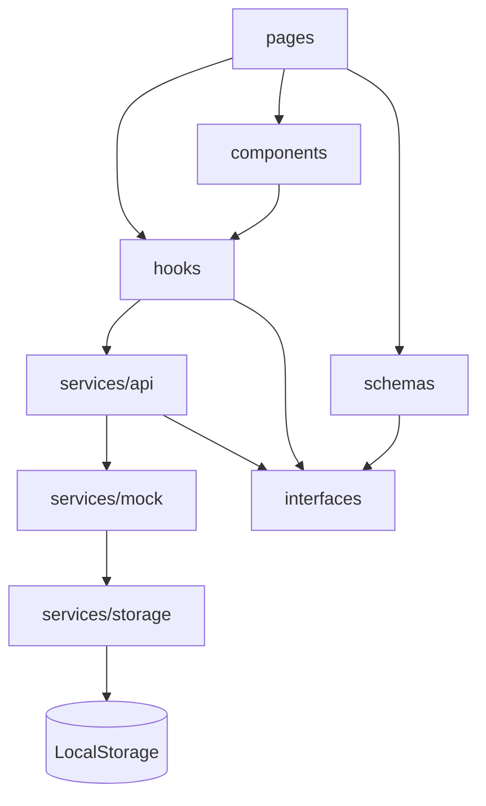

# IronDesk

[Português](./README.pt-BR.md) | **English**

A web management application for gyms and training studios. IronDesk brings a gym's administrative
operation — students, plans, enrollments, billing, attendance, workout programs, physical
assessments, staff and reports — into a single dashboard, with realistic demo data persisted in the
browser.

It is a portfolio project: a complete front end, typed end to end, with business rules real enough to
be exercised without any backend.

---

## 1. Problem

Small and mid-sized gyms usually run their operation with a mix of spreadsheets, paper workout logs,
messaging apps and disconnected billing systems. The outcome is predictable:

- expired enrollments that keep training without anyone noticing;
- delinquency with no consolidated view of what was paid, late or lost;
- workout programs on paper or in WhatsApp threads, with no history per student;
- no attendance visibility, so churn only surfaces after the student has already left;
- reports assembled by hand at the end of every month.

## 2. Solution goals

Centralize that operation in a single dashboard, with the domain's business rules made explicit in
the code:

- **Derived finance**, never typed in: a charge's status (paid, pending, overdue) is computed from
  dates and the amount received, never invented by hand.
- **Enrollment status** computed from validity window, plan and outstanding payments.
- **History per student**: enrollments, payments, workouts, assessments and check-ins reachable from
  a single screen.
- **Management indicators**: revenue, active students, attendance, retention and plan distribution.

## 3. Core features

| Module | What it does |
| --- | --- |
| Dashboard | Revenue, active student, check-in and retention KPIs, monthly trend charts, plan distribution and attention lists (overdue, expiring, assessments) |
| Students | Full CRUD, filters by status/goal, debounced search, detail page with profile and six history tabs |
| Plans | CRUD for monthly, quarterly, semi-annual and annual plans with price, duration, benefits and linked student count |
| Enrollments | Creation, renewal, plan change and cancellation, closing out future charges |
| Finance | Income and expenses, payment settlement, refunds, filters by period and status, cash summary |
| Attendance | Check-in and check-out with computed duration, per-student history and daily view |
| Workouts | Programs per student with exercises (sets, reps, load, rest, muscle group), validity and supervising trainer |
| Assessments | Weight, height, computed BMI, body fat percentage, measurements and comparison against the previous assessment |
| Reports | Revenue series, receivables, distribution by plan and payment method, most frequent students and CSV export |
| Team | Staff CRUD with role, status, contact and hire date |
| Integrations | Integration catalog (gateway, turnstile, email, WhatsApp, accounting) with persisted connect/disconnect |
| Settings | Gym details, operational rules, theme preference and demo data restore |

Across the app: dark (default) and light themes, global search, notification center, toasts, loading
states, empty states, confirmation on destructive actions and a responsive layout.

## 4. Tech stack

- **React 19** + **TypeScript** (strict, no `any`)
- **Vite 6**
- **Tailwind CSS v4** (tokens in CSS, no JS config file)
- **React Router 7**
- **React Hook Form** + **Zod** for forms and validation
- **Recharts** for charts
- **Lucide React** for icons
- **date-fns** for dates
- **clsx** + **tailwind-merge** for class composition

No server, database or external service dependency.

## 5. Architecture



How any piece of data flows through the app:

1. A **page** consumes a **hook** (`useAsyncData`, `useAsyncAction`).
2. The hook calls a **domain service** (`students.service.ts`, `payments.service.ts`, ...).
3. The service applies domain rules and delegates to the matching **mock**.
4. The mock reads and writes through the **storage layer**.
5. **The UI never touches LocalStorage directly.**

This separation is what lets the mock be swapped for a real REST API without rewriting a single
component: it is enough to implement the same contracts under `services/api`.

## 6. Directory structure

```text
src/
├── components/        # UI by domain + primitive kit
│   ├── ui/            # Button, Input, Select, Modal, Table, StatCard, Toast...
│   ├── charts/        # charts and legends
│   ├── layout/        # AppShell, Sidebar, Topbar, global search, notifications
│   ├── students/      # table, form and detail page panels
│   ├── enrollments/   # toolbar, panel, table and enrollment modals
│   ├── finance/       # income, expenses and forms
│   ├── checkins/      # history and duration breakdown
│   ├── workouts/      # card, form and exercise editor
│   ├── assessments/   # comparison and assessment form
│   ├── reports/       # KPIs, charts, tables and export toolbar
│   ├── team/          # staff table and form
│   ├── integrations/  # integration card
│   └── settings/      # settings form
├── constants/         # labels, tones, navigation, palette, company data
├── data/              # exercise catalog
├── hooks/             # useAsyncData, useAsyncAction, useDebounce, useTheme...
├── interfaces/        # domain contracts
├── pages/             # one page per route
├── routes/            # route tree, providers and shell
├── schemas/           # Zod schema per form
├── services/
│   ├── api/           # domain services (business rules)
│   ├── mock/          # data generators and seed
│   └── storage/       # LocalStorage access
├── styles/            # design tokens and component layers
├── types/             # utility types
└── utils/             # dates, currency, status, CSV, ids, classes
```

Every code file is at most **150 lines** — a limit checked at every step.

## 7. Running locally

Requirements: **Node.js 20+** and npm.

```bash
npm install
npm run dev
```

Open [http://localhost:5173](http://localhost:5173).

Production build and preview:

```bash
npm run build
npm run preview
```

Available scripts:

| Script | Description |
| --- | --- |
| `npm run dev` | Development server on port 5173 |
| `npm run build` | Type check (`tsc --noEmit`) + production build |
| `npm run preview` | Serves the production build |
| `npm run typecheck` | Type check only |

## 8. How the mock API works

- Each domain has a service (`services/api/*.service.ts`) with async operations returning `Promise`,
  lightly simulating network latency.
- Raw data is generated by `services/mock/*.mock.ts` from deterministic seeds, so the dashboard always
  opens with coherent numbers.
- Expected errors (missing record, validation, conflict) are thrown as domain exceptions and caught
  by the hooks, which surface a toast and keep the UI consistent.
- No service returns `any`: every response is typed by the domain interfaces.
- Some services return **views** — derived types that already carry aggregated data, such as
  `EnrollmentView` (with student name, plan and computed status) — sparing the UI from having to join
  collections itself.

## 9. How persistence works

```text
LocalStorage
└── irondesk:database       → collections (students, plans, enrollments, payments, ...)
└── irondesk:theme          → theme preference (mirrored in settings.theme)
```

- `services/storage/storage.service.ts` isolates reads/writes, versioning and recovery from corrupted
  data.
- `services/storage/database.service.ts` exposes the typed collections and guarantees the seed is
  generated only on the first run.
- Writes are serialized: changes go through a single write point, so one form never overwrites changes
  from another collection.
- If LocalStorage is unavailable or the payload is invalid, the app regenerates the seed instead of
  breaking.

## 10. Restoring the demo data

In the app: **Settings → Restore demo data**. The action asks for confirmation and recreates every
collection from the original seed, keeping only the theme preference.

From the browser console:

```js
localStorage.removeItem('irondesk:database');
location.reload();
```

## 11. DEMO version limitations

- There is no backend: data lives in the browser and is not shared across devices.
- There is no real authentication; the user shown in the topbar is fictional and part of the demo
  scenario.
- **There are no real charges.** No amount is processed, transferred or reconciled, and no card,
  account or sensitive financial data is collected or stored.
- The integrations listed on the Integrations screen are local state only: no calls are made to
  gateways, turnstiles or messaging providers.
- Reports are computed over the demo dataset and do not replace official accounting.
- File uploads (assessment photos, scanned contracts) are not implemented.

## 12. What production would require

**Backend and data**
- A REST (or GraphQL) API keeping the contracts already defined in `services/api`, with token
  authentication and real pagination.
- A relational database (PostgreSQL with Prisma, for example, or MySQL) with versioned migrations,
  indexes per gym and multi-tenant isolation.
- A queue/worker for async tasks: charge generation, reminders, monthly close.

**Security and privacy**
- Authentication (email/password with strong hashing, or OAuth) and sessions with refresh tokens.
- Role-based access control — administrator, manager, front desk, trainer — restricting routes and
  operations.
- Personal data protection under Brazil's **LGPD**: legal basis, consent, minimization, encryption in
  transit and at rest, access logging and audit trail, retention policy and a channel for erasure and
  portability.
- Payment security: never store card data; use gateway tokenization and PCI-DSS compliance where
  applicable.

**Integrations**
- A payment gateway (Pix, bank slip, card) with idempotent **webhooks** to confirm payments, refunds
  and failures.
- Turnstiles and physical hardware (biometric reader, RFID tag) to grant access based on enrollment
  status.
- Transactional email and WhatsApp for due-date, renewal and birthday reminders.
- Accounting exports and bank reconciliation.

**Operations**
- Automated backups with restore drills, a defined retention policy and off-region copies.
- Error monitoring, business metrics, structured logs and availability alerts.
- Infrastructure with CI/CD, staging and production environments, mandatory HTTPS and environment
  variables for secrets.

**Product**
- A mobile app (student) for workout programs, check-in and progress.
- A student portal with payment and assessment history.

## 13. Integration possibilities

- **Payment gateways**: Pix, bank slip and recurring card.
- **Access control**: turnstiles, electronic locks and biometric/RFID readers.
- **Communication**: transactional email and WhatsApp Business.
- **Accounting**: income and expense exports in a format the accounting firm accepts.
- **Wearables**: import of student workouts and heart rate.
- **Calendar**: synchronization of assessments and due dates.

## 14. Roadmap

- [ ] Authentication and RBAC
- [ ] REST backend + PostgreSQL with migrations
- [ ] Recurring billing with webhooks and reconciliation
- [ ] Student portal and mobile app
- [ ] Physical assessment with photos and visual progress comparison
- [ ] Goals and load progression tracking per exercise
- [ ] Retention automation (churn alert on attendance drop)
- [ ] Multi-location with consolidated indicators
- [ ] Automated business-rule tests and E2E coverage of critical journeys

## 15. Contributing

The `main` branch is protected: nothing gets in through a direct push, everything goes through a pull
request.

1. Read [CONTRIBUTING.md](./CONTRIBUTING.md).
2. Open an issue using one of the templates (bug or feature request).
3. Branch off `main` (`feat/`, `fix/`, `docs/`, `refactor/`, `chore/`).
4. Make sure `npm run typecheck`, `npm run build` and the 150-line-per-file limit pass.
5. Open the pull request — the template and CI kick in automatically.

Questions and open ideas: [Discussions](https://github.com/kaique-albuquerque/irondesk/discussions).
Security issues: follow [SECURITY.md](./SECURITY.md), do not open a public issue.

## 16. Author

Portfolio project built by **Kaique Dias**.

Open source for study and reference.

---

> **Disclaimer:** IronDesk is a demo system. It does not process real charges or store sensitive
> financial information. Every student, staff member, amount and integration shown is fictional.
