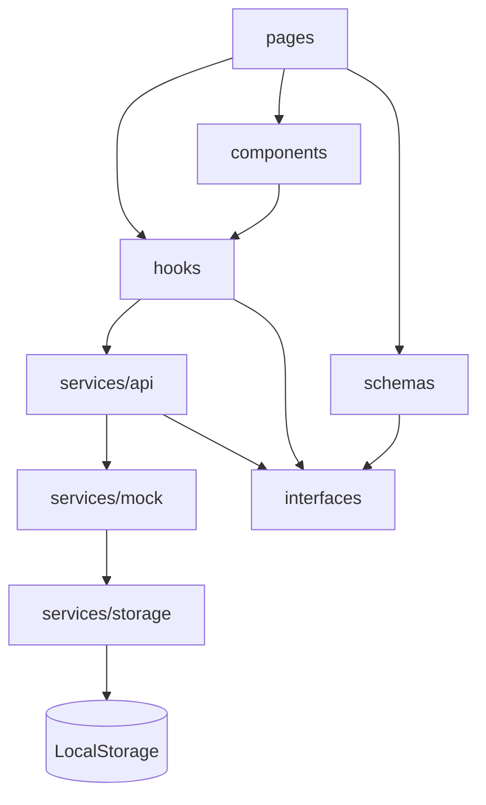

# IronDesk

Aplicação web de gestão para academias e estúdios de treino. O IronDesk reúne a operação
administrativa de uma academia — alunos, planos, matrículas, cobranças, frequência, fichas de
treino, avaliações físicas, equipe e relatórios — em um único painel, com dados de demonstração
realistas e persistidos no navegador.

É um projeto de portfólio: front end completo, tipado de ponta a ponta, com regras de negócio
reais o suficiente para serem testadas sem nenhum backend.

---

## 1. Problema

Academias de pequeno e médio porte normalmente controlam a operação com uma mistura de planilhas,
cadernos de treino, aplicativos de mensagem e sistemas de cobrança desconectados. O resultado é
previsível:

- matrículas vencidas que continuam treinando sem que ninguém perceba;
- inadimplência sem visão consolidada de quanto foi pago, atrasado ou perdido;
- fichas de treino em papel ou em conversas de WhatsApp, sem histórico por aluno;
- nenhuma visão de frequência, então a evasão só aparece quando o aluno já saiu;
- relatórios montados manualmente no fim do mês.

## 2. Objetivo da solução

Centralizar essa operação em um painel único, com as regras de negócio do domínio explícitas no
código:

- **Financeiro derivado**, não digitado: o status de uma cobrança (pago, pendente, atrasado) é
  calculado a partir das datas e do valor recebido, nunca inventado manualmente.
- **Situação da matrícula** calculada por vigência, plano e pendências financeiras.
- **Histórico por aluno**: matrículas, pagamentos, treinos, avaliações e check-ins acessíveis em uma
  única tela.
- **Indicadores de gestão**: receita, alunos ativos, frequência, retenção e distribuição por plano.

## 3. Principais funcionalidades

| Módulo | O que faz |
| --- | --- |
| Dashboard | KPIs de receita, alunos ativos, check-ins e taxa de retenção, gráficos de evolução mensal, distribuição por plano e listas de atenção (atrasos, vencimentos, avaliações) |
| Alunos | CRUD completo, filtros por status/objetivo, busca com debounce, página de detalhe com perfil e seis abas históricas |
| Planos | CRUD de planos mensais, trimestrais, semestrais e anuais com preço, duração, benefícios e contagem de alunos vinculados |
| Matrículas | Criação, renovação, troca de plano e cancelamento, com encerramento das cobranças futuras |
| Financeiro | Receitas e despesas, baixa de pagamentos, estorno, filtros por período e situação, resumo de caixa |
| Frequência | Check-in e check-out com permanência calculada, histórico por aluno e visão diária |
| Treinos | Fichas por aluno com exercícios (séries, repetições, carga, descanso, grupo muscular), validade e professor responsável |
| Avaliações | Peso, altura, IMC calculado, percentual de gordura, medidas e comparativo com a avaliação anterior |
| Relatórios | Séries de receita, recebíveis, distribuição por plano e método de pagamento, alunos mais assíduos e exportação CSV |
| Equipe | CRUD de colaboradores com cargo, status, contato e data de admissão |
| Integrações | Catálogo de integrações (gateway, catraca, e-mail, WhatsApp, contabilidade) com conexão/desconexão persistida |
| Configurações | Dados da academia, regras operacionais, preferência de tema e restauração dos dados de demonstração |

Transversalmente: tema escuro (padrão) e claro, busca global, central de notificações, toasts,
estados de carregamento, estados vazios, confirmação em ações destrutivas e layout responsivo.

## 4. Tecnologias

- **React 19** + **TypeScript** (strict, sem `any`)
- **Vite 6**
- **Tailwind CSS v4** (tokens em CSS, sem arquivo de configuração JS)
- **React Router 7**
- **React Hook Form** + **Zod** para formulários e validação
- **Recharts** para os gráficos
- **Lucide React** para ícones
- **date-fns** para datas
- **clsx** + **tailwind-merge** para composição de classes

Nenhuma dependência de servidor, banco de dados ou serviço externo.

## 5. Arquitetura



Fluxo de qualquer dado na aplicação:

1. A **página** consome um **hook** (`useAsyncData`, `useAsyncAction`).
2. O hook chama um **serviço de domínio** (`students.service.ts`, `payments.service.ts`, ...).
3. O serviço aplica as regras do domínio e delega ao **mock** correspondente.
4. O mock lê e grava através da **camada de storage**.
5. A **interface nunca toca o LocalStorage diretamente**.

Essa separação é o que permite trocar o mock por uma API REST real sem reescrever nenhum
componente: basta implementar os mesmos contratos em `services/api`.

## 6. Estrutura de diretórios

```text
src/
├── components/        # UI por domínio + kit de primitivos
│   ├── ui/            # Button, Input, Select, Modal, Table, StatCard, Toast...
│   ├── charts/        # gráficos e legendas
│   ├── layout/        # AppShell, Sidebar, Topbar, busca global, notificações
│   ├── students/      # tabela, formulário e painéis da página de detalhe
│   ├── enrollments/   # toolbar, painel, tabela e modais de matrícula
│   ├── finance/       # receitas, despesas e formulários
│   ├── checkins/      # histórico e detalhamento de permanência
│   ├── workouts/      # card, formulário e editor de exercícios
│   ├── assessments/   # comparativo e formulário de avaliação
│   ├── reports/       # KPIs, gráficos, tabelas e toolbar de exportação
│   ├── team/          # tabela e formulário de colaboradores
│   ├── integrations/  # card de integração
│   └── settings/      # formulário de configurações
├── constants/         # labels, tons, navegação, paleta, dados da empresa
├── data/              # catálogo de exercícios
├── hooks/             # useAsyncData, useAsyncAction, useDebounce, useTheme...
├── interfaces/        # contratos de domínio
├── pages/             # uma página por rota
├── routes/            # árvore de rotas, providers e shell
├── schemas/           # schemas Zod por formulário
├── services/
│   ├── api/           # serviços de domínio (regras de negócio)
│   ├── mock/          # geradores de dados e seed
│   └── storage/       # acesso ao LocalStorage
├── styles/            # tokens de design e camadas de componentes
├── types/             # tipos utilitários
└── utils/             # datas, moeda, status, CSV, ids, classes
```

Cada arquivo de código tem no máximo **150 linhas** — limite verificado manualmente a cada etapa.

## 7. Como executar localmente

Requisitos: **Node.js 20+** e npm.

```bash
npm install
npm run dev
```

Acesse [http://localhost:5173](http://localhost:5173).

Build de produção e pré-visualização:

```bash
npm run build
npm run preview
```

Scripts disponíveis:

| Script | Descrição |
| --- | --- |
| `npm run dev` | Servidor de desenvolvimento na porta 5173 |
| `npm run build` | Verificação de tipos (`tsc --noEmit`) + build de produção |
| `npm run preview` | Serve o build de produção |
| `npm run typecheck` | Apenas a verificação de tipos |

## 8. Como funciona o Mock API

- Cada domínio tem um serviço (`services/api/*.service.ts`) com operações assíncronas que retornam
  `Promise`, simulando latência de rede de forma discreta.
- Os dados brutos são gerados por `services/mock/*.mock.ts` a partir de seeds determinísticos, para
  que o dashboard abra sempre com números coerentes.
- Erros esperados (registro inexistente, validação, conflito) são lançados como exceções de domínio
  e capturados pelos hooks, que exibem um toast e mantêm a interface consistente.
- Nenhum serviço retorna `any`: todas as respostas são tipadas pelas interfaces de domínio.
- Alguns serviços retornam **views** — tipos derivados que já trazem dados agregados, como
  `EnrollmentView` (com nome do aluno, plano e situação calculada) — evitando que a interface precise
  cruzar coleções.

## 9. Como funciona a persistência

```text
LocalStorage
└── irondesk:database       → coleções (students, plans, enrollments, payments, ...)
└── irondesk:theme          → preferência de tema (espelhada em settings.theme)
```

- `services/storage/storage.service.ts` isola leitura/escrita, versionamento e recuperação de dados
  corrompidos.
- `services/storage/database.service.ts` expõe as coleções tipadas e garante que o seed seja gerado
  apenas na primeira execução.
- A escrita é serializada: alterações passam por um único ponto de gravação, então um formulário
  nunca sobrescreve alterações de outra coleção.
- Se o LocalStorage estiver indisponível ou o payload inválido, a aplicação regenera o seed em vez de
  quebrar.

## 10. Como restaurar os dados demonstrativos

Na aplicação: **Configurações → Restaurar dados de demonstração**. A ação pede confirmação e
recria todas as coleções com o seed original, mantendo apenas a preferência de tema.

Via console do navegador:

```js
localStorage.removeItem('irondesk:database');
location.reload();
```

## 11. Limitações da versão DEMO

- Não há backend: os dados vivem no navegador e não são compartilhados entre dispositivos.
- Não há autenticação real; o usuário exibido na topbar é fictício e faz parte do cenário de
  demonstração.
- **Não há cobranças reais.** Nenhum valor é processado, transferido ou conciliado, e nenhum dado de
  cartão, conta ou documento financeiro sensível é coletado ou armazenado.
- Integrações listadas na tela de Integrações são apenas estado local: não há chamadas a gateways,
  catracas ou provedores de mensagem.
- Relatórios são calculados sobre o conjunto demonstrativo e não substituem contabilidade oficial.
- Upload de arquivos (fotos de avaliação, contratos digitalizados) não está implementado.

## 12. O que seria necessário para produção

**Backend e dados**
- API REST (ou GraphQL) mantendo os contratos já definidos em `services/api`, com autenticação por
  token e paginação real.
- Banco relacional (PostgreSQL com Prisma, por exemplo, ou MySQL) com migrações versionadas,
  índices por academia e isolamento multi-tenant.
- Fila/worker para tarefas assíncronas: geração de cobranças, lembretes, fechamento mensal.

**Segurança e privacidade**
- Autenticação (e-mail/senha com hash forte, ou OAuth) e sessões com refresh token.
- RBAC por função — administrador, gerente, recepção, professor — restringindo rotas e operações.
- Proteção de dados pessoais conforme a **LGPD**: base legal, consentimento, minimização,
  criptografia em trânsito e em repouso, registro de acesso e trilha de auditoria, política de
  retenção e canal para exclusão/portabilidade.
- Segurança de pagamentos: nunca armazenar dados de cartão; usar tokenização do gateway e
  conformidade PCI-DSS quando aplicável.

**Integrações**
- Gateway de pagamento (Pix, boleto, cartão) com **webhooks** idempotentes para confirmar
  pagamentos, estornos e falhas.
- Catracas e equipamentos físicos (leitor biométrico, tag RFID) para liberar acesso conforme a
  situação da matrícula.
- E-mail transacional e WhatsApp para lembretes de vencimento, renovação e aniversário.
- Exportação para contabilidade e conciliação bancária.

**Operação**
- Backup automático com teste de restauração, retenção definida e cópia fora da região principal.
- Monitoramento de erros, métricas de negócio, logs estruturados e alertas de indisponibilidade.
- Infraestrutura com CI/CD, ambientes de staging e produção, HTTPS obrigatório e variáveis de
  ambiente para segredos.

**Produto**
- Aplicativo mobile (aluno) para ficha de treino, check-in e evolução.
- Portal do aluno com histórico de pagamentos e avaliações.

## 13. Possibilidades de integração

- **Gateways de pagamento**: Pix, boleto e cartão recorrente.
- **Controle de acesso**: catracas, fechaduras eletrônicas e leitores de biometria/RFID.
- **Comunicação**: e-mail transacional e WhatsApp Business.
- **Contabilidade**: exportação de receitas e despesas em formato aceito pelo escritório contábil.
- **Wearables**: importação de treinos e frequência cardíaca do aluno.
- **Calendário**: sincronização de avaliações e vencimentos.

## 14. Roadmap

- [ ] Autenticação e RBAC
- [ ] Backend REST + PostgreSQL com migrações
- [ ] Cobrança recorrente com webhooks e conciliação
- [ ] Portal e aplicativo do aluno
- [ ] Avaliação física com fotos e comparativo visual de evolução
- [ ] Metas e acompanhamento de progressão de carga por exercício
- [ ] Automação de retenção (alerta de evasão por queda de frequência)
- [ ] Multi-unidade com consolidação de indicadores
- [ ] Testes automatizados de regras de negócio e E2E das jornadas críticas

## 15. Como contribuir

A branch `main` é protegida: nenhuma alteração entra por push direto, tudo passa por pull request.

1. Leia o [CONTRIBUTING.md](./CONTRIBUTING.md).
2. Abra uma issue usando um dos templates (bug ou sugestão de funcionalidade).
3. Crie a branch a partir da `main` (`feat/`, `fix/`, `docs/`, `refactor/`, `chore/`).
4. Garanta `npm run typecheck`, `npm run build` e o limite de 150 linhas por arquivo.
5. Abra o pull request — o template e a CI entram automaticamente.

Dúvidas e ideias abertas: [Discussions](https://github.com/kaique-albuquerque/irondesk/discussions).
Falhas de segurança: siga o [SECURITY.md](./SECURITY.md), não abra issue pública.

## 16. Autor

Projeto de portfólio desenvolvido por **Kaique Dias**.

Código aberto para estudo e referência.

---

> **Aviso:** o IronDesk é um sistema demonstrativo. Não realiza cobranças reais nem armazena
> informações financeiras sensíveis. Todos os alunos, colaboradores, valores e integrações exibidos
> são fictícios.
